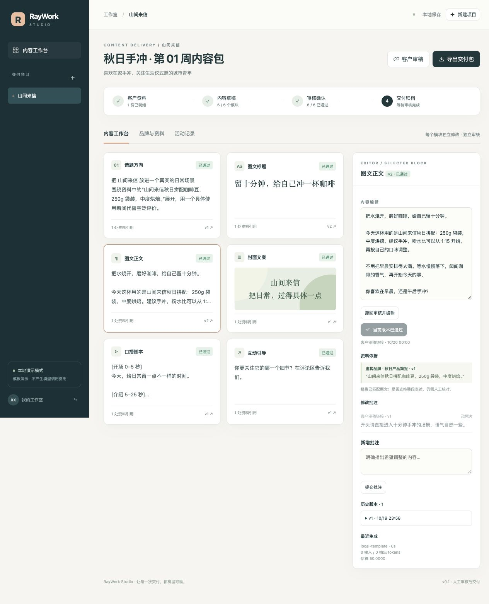

<div align="center">

# RayWork Studio

**把客户资料，变成经过审核、版本清楚、可以直接交付的内容包。**

A local-first, evidence-aware content delivery workspace for small studios.

[快速开始](#快速开始) · [试用流程](#用-5-分钟走完一次交付) · [产品路线](docs/ROADMAP.md) · [架构与边界](docs/ARCHITECTURE.md)

</div>



内容工作室经常在聊天记录、文档和 AI 对话之间反复搬运：客户改了一句，哪个版本才算确认？产品资料更新后，哪些文案要重做？最后交付的文本和审核记录能否对上？

RayWork 把这些事放进同一个项目：**资料 → 6 个内容模块 → 批注 → 局部修改 → 逐项审核 → ZIP 交付**。

> **v0.1 是可以本地运行的产品原型。** 默认演示模式使用透明标注的本地模板，不冒充 AI 生成。真实生成已接入 OpenAI Responses API，需自行配置 Key 和支持 Structured Outputs 的模型。当前验证包括 API 模拟测试和浏览器操作；尚未用真实模型额度验证内容质量，也没有付费客户或营收数据。

## 现在能做什么

| 交付环节 | 已实现的行为                                                             |
| -------- | ------------------------------------------------------------------------ |
| 品牌资料 | 一个项目绑定品牌、受众、语气、禁用表达和主资料文档                       |
| 内容包   | 选题方向、图文标题、图文正文、封面文案、口播脚本、互动引导               |
| 资料引用 | 每个模块带来源摘录；摘录必须逐字存在于对应资料中                         |
| 局部重写 | 只重写指定模块，保留其他模块和历史版本                                   |
| 客户审稿 | 72 小时有效的项目链接；可批注、审核，可一键撤销所有链接                  |
| 审核保护 | 旧版本不能确认；已通过内容需撤回后修改；未解决批注会阻止通过             |
| 资料变更 | 引用该资料的模块变成过期状态，需要重写和重新审核                         |
| 交付导出 | 6 个模块都通过后，导出 Markdown 文本和带版本、依据、审核记录的 JSON 清单 |
| 任务恢复 | 任务持久化、幂等请求、手动失败重试、重启中断标记；不自动重复计费调用     |
| 调用记录 | 记录成功任务的耗时与 tokens；按操作者设置的单价估算成本                  |

**引用匹配不等于事实核验。** 系统验证摘录是否存在，不证明内容里的每句话都受摘录支持。手工改稿也不会自动补齐证据，需要编辑和客户核对。演示封面只是文字排版预览，口播脚本不包含实际视频文件。

## 快速开始

需要 Python 3.11+。默认无需 Node、数据库服务或模型 Key。

```bash
git clone https://github.com/CodeRayZhang/raywork-studio.git
cd raywork-studio
python3 -m venv .venv
source .venv/bin/activate
pip install -e '.[dev]'
raywork
```

打开 <http://127.0.0.1:8787>，将 `.state/admin-token` 的内容粘贴到登录页。令牌由本地首次启动生成，页面只在当前标签页会话保存它。

```bash
cat .state/admin-token
```

Windows 可使用 `.venv\Scripts\activate` 激活环境。也可直接 `python -m raywork.cli` 启动。更换端口：`raywork --port 8788`。数据保存在启动目录的 `.state/`，退出或重启不会丢失。

## 用 5 分钟走完一次交付

1. 点击「载入演示项目」，打开虚构咖啡品牌“山间来信”的 6 模块内容包。
2. 打开标题，手动修改并保存，看到版本从 v1 变成 v2。
3. 点击「客户审稿」，在新标签页打开链接，为正文留一条修改意见。
4. 回到工作台刷新，修改正文，标记批注已解决；客户再次打开并通过当前版本。
5. 逐项审核其余模块，点击「导出交付包」，检查 `content/*.md` 与 `manifest.json`。

再试一个异常：修改「品牌与资料」中的产品规格，引用它的内容会重新待审，不能直接交付。演示模式的「局部重写」只附上修改要求并重置模板内容，用于体验流程；智能改写需要真实模式。

## 启用真实模型

只在服务端配置环境变量，不要把模型 Key 放进浏览器、GitHub 或交付文件。`.env` 不会自动加载；使用 shell、部署平台或容器的环境变量管理功能。

```bash
export OPENAI_API_KEY='你的 API Key'
export OPENAI_MODEL='你账户可调用且支持 Structured Outputs 的模型 ID'
raywork --mode openai
```

模型设置、结构化输出形式参考 [OpenAI 官方文档](https://developers.openai.com/api/docs/guides/structured-outputs)。点击生成会将该项目的品牌简报、主资料和必要的当前模块信息发送给 OpenAI；请求设置 `store: false`。这不代表服务商完全不保留任何数据，实际数据处理以服务商政策为准。

可选配置 `INPUT_USD_PER_MILLION` 和 `OUTPUT_USD_PER_MILLION`（美元/百万 tokens），显示简化的输入输出成本估算。未配置时显示“未估算”；不精确处理缓存、阶梯价等价格细节。失败任务可能已消耗模型额度，当前不能可靠记录所有失败调用的用量，请以服务商账单为准。

## Docker

```bash
docker compose up --build
docker compose exec studio cat /data/admin-token
```

默认只暴露到宿主机 `127.0.0.1:8787`，数据放在命名卷里。Docker 配置已提供，当前本地验收使用 Python 进程，尚未实际运行 Docker 构建。

发给外部客户使用时，需要自己部署可访问的服务、配置 HTTPS 和备份。localhost 审稿链接不能直接在客户的电脑上打开。此版本是**单工作室、单进程**，不要部署多个 worker 或共享数据库给多个服务实例。

## 测试与结构

```bash
pytest -q
```

测试覆盖客户批注到导出的完整链路、越权访问、链接过期/撤销、过期版本审核、并发编辑、来源变更、任务幂等与重试、结构化模型响应和无效引用拒绝。测试不会连接真实模型服务。

```text
raywork/
  api.py          # 工作流、版本检查、审核权限、导出
  generator.py    # 本地模板与 OpenAI 结构化生成适配
  store.py        # SQLite 事务与任务状态
  cli.py          # 本地启动与令牌管理
  static/         # 无构建步骤的浏览器工作台
tests/            # 工作流集成与模型适配测试
docs/             # 架构、验收、产品路线
```

## 接下来验证什么

先找 3 个小型内容工作室，用真实的一个客户项目完成两轮交付，记录人工修改时间、返工次数、客户审核时间和愿付价格。之后再决定是否做多品牌管理、团队账号、持续任务队列和托管订阅。

目前不包含多租户账号、账单支付、平台自动发布、图片/视频生成、PDF/网页抓取或真实经营报告。具体顺序见 [产品路线与试点方案](docs/ROADMAP.md)。

欢迎通过 Issue 提交可复现的问题或内容交付场景，请使用脱敏材料。MIT License。
