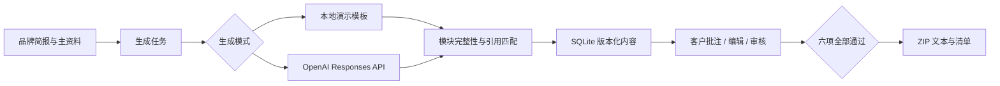

# 架构与运行边界

## 数据流

FastAPI 同源提供 REST API 与静态界面，无 CDN、第三方前端脚本和分析埋点。SQLite 使用 WAL 和写事务；项目作为 JSON 文档保存，适合早期单工作室规模，后续再拆分关系表。项目的 `events` 是应用日志，不是不可篡改的审计账本。

## 关键规则

- 内容按 `key + version` 修改或审核。写入前在事务中检查版本，防止两个编辑覆盖彼此。
- 已通过模块需显式撤回；批注会撤销原审核，未解决批注阻止再次通过。
- 新版本保留历史文本、引用和状态。历史意见继续保留，操作者需在当前版本标记解决。
- 资料更新会递增来源版本，并使引用它的模块失效。手工修改文本不会清除失效标记，需基于新资料重新生成。
- 生成任务保存输入快照和资料指纹。回写前重新验证指纹、目标版本和审核状态，避免覆盖生成期间的改动。
- 每个项目同时最多运行一个任务。请求键在项目内唯一，同键不同参数会被拒绝。
- 失败任务只能人工重试，最多 3 次尝试。服务启动会将中断的任务置为失败，不会自动重发模型请求。
- 全部 6 个模块通过、无失效来源、无未解决意见后才能导出。清单记录导出快照，用户随后修改不会改变已下载的文件。

## 权限

管理 API 使用至少 24 字符的 bearer token。CLI 默认随机生成，并把状态目录设为 0700、初始令牌文件设为 0600；可用 `RAYWORK_ADMIN_TOKEN` 覆盖。前端令牌保存在 sessionStorage，URL 引导片段读取后立即移除。

客户审稿链接持有者可访问指定项目的品牌资料、当前内容、引用、批注并确认审核。服务端只存令牌哈希，72 小时后过期；管理员可以撤销项目全部链接。它不是实名签署：记录中的“客户审稿链接”只表示持有该链接的人，不证明具体身份。客户不能读取其他项目、历史草稿、成本、任务，也不能编辑资料或调用生成接口。

使用 CSP 限制同源资源，禁止嵌入；用户文本通过 HTML 转义显示。令牌不放进查询参数，Referrer-Policy 为 no-referrer。未提供面向公网的登录尝试限流、账号恢复、多成员角色系统或运营监控。

## 生成与事实边界

资料被当作数据传入模型，模型没有工具执行权限。结构化输出要求固定模块，服务端再次检查模块与引用。但模型提示词和原文匹配不能证明每一句话的事实正确性，也不能保证品牌风格稳定，人工审核始终是交付条件。

现阶段只有一份主资料文档的编辑 UI；后端为未来多个来源保留了来源 ID 设计。资料完整旧版本未单独存档，历史内容保留当时的摘录和版本标识，不能用作长期合规资料库。

后台任务运行在 FastAPI 进程内，不是独立任务队列。仅支持单进程、单实例；高并发、团队协作或公网托管前需要持久化任务队列、配额限流、数据迁移和备份演练。

备份时停止服务，再复制整个 `.state` 目录；其中包含管理令牌、客户资料、内容和 SQLite 数据，作为私有数据保管，不上传开源仓库。
